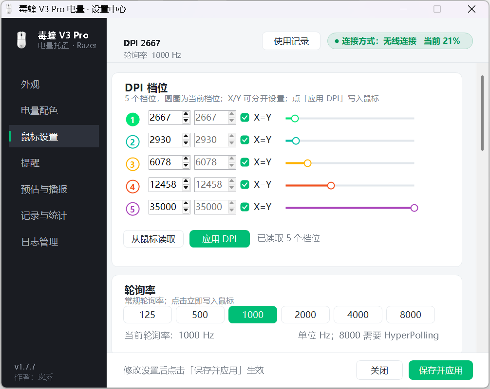

# RazerV3BatteryTray — 雷蛇毒蝰 V3 Pro 任务栏电量显示

**版本 1.7.7 · 作者：岚乔**



> 版本规则：功能新增/大改动 → 次版本号（1.x）；bug 修复 → 修订号（1.2.x）。每次改动同步更新源码 `[assembly: AssemblyVersion]`、设置页左下角版本标签与启动日志。

## 更新记录
- 1.7.7（2026-11-12）：成功/失败提示改为顶栏红框区域内的绿/红文字（透明背景、1.6 秒后恢复 DPI 显示），不再弹独立小窗；修复 DPI 档位 X/Y 数字框与 X=Y 开关、曲线图坐标数字与轴标题的重叠；高级「自定义」曲线 5 个控制点可上下拖动并保存；曲线图新增跟随鼠标移动速度的实时填充动画（动作停下 120ms 后清空）
- 1.7.6（2026-11-12）：鼠标设置页继续扩展——DPI 每档独立配色（绿/青/琥珀/橙/紫）、X/Y 分离（每档 X=Y 联动开关）、电源（闲置 1–15 分钟进入睡眠、低电量阈值 5–100%）、校准（非对称中止抬升 2–26 / 着陆 1–25）、高级（动态灵敏度 4 种曲线 + 旋转 -44°~44°，Synapse 软件功能仅预览）；顶部 DPI/轮询率两行可点击跳转鼠标设置；读取/应用成功绿字、失败红字弹窗；所有新增设置全部集中在「鼠标设置」页
- 1.7.5（2026-11-12）：新增「鼠标设置」页——DPI 5 档读写（当前 DPI、各档 DPI、当前档位）、轮询率 125/500/1000/2000/4000/8000 读写、全屏游戏智能轮询（本程序实现：进游戏切游戏轮询率、退出恢复常规轮询率，可与 Synapse 二选一）；设置页顶部红色区域新增 DPI/轮询率两行实时值；托盘悬浮提示在鼠标名字下新增「DPI xxx · 轮询率 xxxxHz」，游戏切到智能轮询率时同步显示当前值；DPI/轮询率协议实测（04/85、04/86、04/06、00/C0、00/40）
- 1.7.4（2026-11-12）：修复设置页外观——样式下拉框恢复标准边框（不再隐进白卡片）、"电池自动"文字加宽不再截断、电池数字提示缩短；电池主体再加大到约 20×18（占满 24px 托盘图标，正极帽仍独立可见）；MSI 升到 1.7.4，双击新版直接覆盖升级，升级时保留 `config\`、`log\` 与开机自启设置
- 1.7.3（2026-11-12）：电池图标全面重做——横向/竖向两种电池统一 Win11 原生观感（主题色粗描边、独立正极帽留缝、按电量阈值填充、无深灰底槽、浅色任务栏自动黑/深色自动白）；数字画在电池体内，移除"电池+百分比(Win)"与"数字在图标旁（双格）"两个方案（任务栏两图标之间是系统固定槽距，贴不近且显小）；电池按托盘实际 24px 像素 1:1 渲染并尽量占满图标（主体高度约占 3/4），描边/正极帽更清晰；数字颜色新增"自动"（跟随任务栏深浅色、自动去描边）
- 1.7.2（2026-11-08）：修复休眠/唤醒记录漏记——无线接收器常驻时，鼠标睡下只是电量读不到（`online` 仍为 True），旧逻辑只认设备掉线，导致整夜休眠和早上唤醒都没有记录；现在电量持续读不到 ≥90 秒即开档记入睡、恢复可读即记唤醒，并新增系统睡眠长空档检测（≥2 分钟）。电量未知（-1）不再被误记为「醒来 -1%」或「开机首次连接 -1%」
- 1.7.1（2026-11-08）：程序图标换成毒蝰 V3 Pro 白色鼠标实拍造型（透明背景、无边框），补齐 16/20/24/32/40/48/64/96/128/256 共 10 档尺寸；窗口、任务栏、Alt-Tab 与设置页 Logo 同步更新；`CreateIco` 改为从 `mouse_icon_source.png` 生成；提供可自定义安装路径的 MSI 安装包（安装/卸载页面使用主程序鼠标图标，卸载自动关闭程序并清理程序文件、配置、日志、开始菜单、自启动项与安装目录）
- 1.7.0（2026-11-06）：设置界面全面重做——深色侧边栏 + 卡片式六页布局（外观 / 电量配色 / 提醒 / 预估与播报 / 记录与统计 / 日志管理），重新排布控件间距与字号，高 DPI 下不再挤压或截断；新增「使用记录」弹窗，可按日期筛选查看唤醒 / 休眠 / 充电 / 充满 / 没电等事件，支持「清除此日期」与「清空全部记录」；使用记录保留上限提升至 500 条；设置窗默认位置改为屏幕水平居中、垂直略偏上
- 1.6.6（2026-10-27）：外缘圆滑度回归修复——突破内切版(rOut=0.5S)四极点抗锯齿像素被画布硬裁致圆滑度下降；回收到恰好内切(0.5S-0.5px)，极点保留 1-2 级半透明渐变（实测四极点 alpha 剖面 87/124→255 连续），尺寸损失 1px 视觉无感
- 1.6.2~1.6.5（2026-10-26/27）：托盘图标尺寸全面实验定论——实测本机任务栏行高 44px、图标高度普查（17 个图标 20-44px）：方形满幅 41-44px，圆形/环形图标 28-36px（我们 33px 已在圆类上限，与方形差为内切几何天性）。已做：环外缘突破内切（rOut=0.5S）、画布 48/96/44px 三档实验（证明 hicon 尺寸不影响托盘显示，系统固定槽缩放）、默认环粗 6 增强视觉存在感
- 1.6.2（2026-10-26）：托盘图标显小根治——实测任务栏 72px 高、图标槽非 48px，之前 48px hicon 被系统 1.5 倍非整数降采样后内容缩小一截（截图对比邻图标小一圈多）。改渲染 96px 大画布：任何槽位（32/48）都是整数倍干净缩放，配合 87.5% 内容占比与默认环粗 5，视觉尺寸与其他应用图标对齐
- 1.6.1（2026-10-26）：图标视觉放大——环外缘贴画布边（去 7.5% 留白）、全部样式内容区扩到 2-4% 边距、程序图标（白鼠标）同步贴边、默认环粗 4→5。实测内容占比 87.5%（圆内切方的物理上限，环中空是圆形主题固有视觉差）
- 1.6.0（2026-10-22）：生命周期精准记录——①入睡状态持久化（此前仅内存态，程序重启即丢，休眠记录无法闭环的根因）②开机首次连接事件（电量+连接方式）③关机断开事件（SessionEnding 监听，关机期间掉电并入下次唤醒闭环）④休眠弹窗显示进行中的未闭区间
- 1.5.7（2026-10-21）：预览框修复——合成画布与预览框同尺寸（276x72，黑底满框规则矩形）并加大；保存/关闭按钮焦点虚线框隐藏（WM_CHANGEUISTATE）；日志/记录组按钮改绝对定位（FlowPanel AutoSize 撑宽是横滚回归根因）并收紧行距
- 1.5.3~1.5.6（2026-10-21）：设置窗布局最终定稿——保存并应用/关闭/版本号做成 Dock=Bottom 底部操作栏，无论竖向滚动条滚到哪永远钉在窗体最底可见可点（此前反复看不到保存按钮的根治）；竖滚条件化保留（内容超屏时出现，保证看完整）；横滚彻底禁用；窗高用真实 DPI 换算（修复 Font 缩放比值误算导致窗体被裁）；数字墨迹中心对齐图形几何中心
- 1.5.1/1.5.2（2026-10-21）：数字居中改墨迹中心对齐（字形视觉中心=环几何中心，可占环内空间、字号仍由用户调节）；设置窗消灭全部滚动条——高度压缩（预览框 96→56、列表 3→2 行、阈值表 116→88、组距/行距收紧），实测 1494px 全量装进 2.5K@150% 工作区，保存按钮等底部控件直接可视
- 1.5.0（2026-10-21）：①托盘图标按 DPI 原生渲染（150% 屏 48px 画布替代 32px 系统拉伸——非整数倍插值是圆环不圆的最终根因）；②数字绝对居中——ring 数字区改环内径内切正方形，四角到环外圈等距；③设置窗高度跟随屏幕工作区（修复 2.5K@150% 纵滚拉底仍见不到保存按钮+横向滚动条，窗口 632x790 全内容可视）；④数字视觉位置整体上移校正基线偏差
- 1.4.5（2026-10-21）：弧端凹角修复——环带端面改为真半圆凸弧封口（圆心=带宽中点，替换平弦端面+补圆片拼接），右下角弧终点实测 13 方向带跨度 5.4-6.2px 无凹口；gauge 仪表盘统一环带填充法
- 1.4.4（2026-10-21）：边缘光滑终版——超采样 4→8 倍 + 降采样加 WrapModeTileFlipXY 消除半像素偏移；整环 24 方向实测 alpha 过渡 2-4 级连续渐变（旧版 1.5-2 级带孤立档），圆环边缘丝滑如系统原生图标
- 1.4.3（2026-10-21）：圆环颗粒感修复——环改环带填充法（外弧+内弧闭合路径整体 Fill + 端部圆头圆片），粗笔弧斜段的离散半透明暗点（实测 alpha 60/0/60 跳变行）消除，实测暗颗粒 0
- 1.4.2（2026-10-17）：圆环/仪表盘边缘修复——底槽弧改为只画电量缺口段（与电量弧首尾相接），消除两弧同位叠画产生的断续深灰晕边；底槽色提亮至 (120,124,132)
- 1.4.1（2026-10-17）：设置窗全宽统一收窄——预览/阈值颜色/其余各组对齐 572 列宽、窗体 600，消除各组右侧留白不一致
- 1.4.0（2026-10-17）：悬浮提示改平行分行显示（设备 / 2.4G 或有线连接 / 电量 / 预估四行）；设置页两个列表框收窄至 540 与日志管理组内容对齐，消除右侧留白
- 1.3.2（2026-10-17）：修复预估长期不出——采样改为电量变化时才记录（3 秒轮询全存导致 200 条窗口仅覆盖 10 分钟，掉电历史被冲掉）；自启项直写 exe 绝对路径（去 VBS 层，任务管理器正确显示程序名/图标/路径）
- 1.3.1（2026-10-17）：修复记录组/日志组按钮重叠（改 FlowLayoutPanel 流式排布）；程序图标改为白色鼠标造型（深色描边+分键线+清晰深色滚轮，16/24/32/48 四尺寸超采样）
- 1.3.0（2026-10-17）：掉电段算法优化（1% 抖动容差 + 5 分钟成段，100→89 未出预估的问题修复）；充电时长预估（悬浮显示"X 小时 Y 分后充满"）与充电耗时记录（开始充电→充满，秒级）；休眠/唤醒使用记录弹窗（入睡/唤醒时刻+电量、休眠时长与耗电）；设置页新增"休眠/唤醒记录""充电耗时记录"按钮
- 1.2.1（2026-10-13）：修复拔线后连续"充满电"误记——满电仅在充电态判定，拔线即记"拔线开始耗电"并终结满电态；续航统计起点改为拔线时刻；设置页顶部加连接方式条；列表禁横向滚动条（窗体加宽至 760 容纳整行）
- 1.2.0：有线/无线双链路自动切换、连接类型显示、协议响应校验（防 0x1C/0x93 推送误读）、续航统计（秒级）、日志管理（50MB 归档 cab→tar.gz）、目录标准化（config\ log\）

不依赖 Razer Synapse、不需要管理员权限的任务栏托盘电量指示器，通过逆向的雷蛇 HID 协议直连鼠标（有线或 HyperPolling 接收器均可）。

## 下载

- 安装包：到 [Releases](../../releases/latest) 下载最新的 `RazerV3BatteryTray_Setup_1.7.7.msi`
- 绿色使用：自行编译 `RazerV3BatteryTray.exe` 后双击运行（编译方法见文末）

## 快速使用

- 双击 `RazerV3BatteryTray.exe` 运行，托盘出现电量图标
- 双击托盘图标 → 打开设置
- 托盘右键 → 设置 / 使用记录 / 立即刷新 / 预估可用时长 / 退出
- 所有设置保存在 `config\settings.xml`，运行日志 `log\razer_battery_tray.log`

## 安装包（MSI）

- 安装包：`dist\RazerV3BatteryTray_Setup_1.7.7.msi`（已发布到 GitHub Releases；源码仓库不包含 `dist\` 构建产物）
- 当前用户安装，无需管理员；默认安装到 `%LocalAppData%\RazerV3BatteryTray`
- 安装向导「目标文件夹」页可直接修改路径，或点「更改」选择其他可写目录
- 安装后创建开始菜单「毒蝰 V3 Pro 电量」和「设置中心」快捷方式
- 卸载：Windows 设置 → 应用 → 已安装的应用 → 雷蛇毒蝰 V3 Pro 电量托盘 → 卸载
- 卸载会自动关闭正在运行的程序，并删除：程序文件、`config\`、`log\`（含归档）、开始菜单快捷方式、`HKCU\Software\Microsoft\Windows\CurrentVersion\Run\RazerV3BatteryTray` 自启动项、安装目录（目录为空时）以及 MSI 注册信息
- 安装向导和 Windows「应用」列表使用主程序鼠标图标；MSI 右键属性中的标题（RazerV3BatteryTray）、主题（产品名）、作者（岚乔）、备注（功能描述）与 exe 一致；版本号 1.7.7（MSI 版本字段最多三段，exe 为 1.7.7.0）

## 功能

### 电量显示
- 每隔 N 秒（默认 60，可调 1–3600）主动向鼠标查询电量与充电状态
- **12 种图标样式**：纯文字、圆环、鼠标造型、**电池（横向/竖向，Win11 原生观感）**、进度条（横向/竖向）、闪电形、圆形水位、仪表盘、六边形、水滴
- **鼠标设置页**：DPI 5 档读写（每档独立配色、X/Y 可分开/联动）、轮询率 125/500/1000/2000/4000/8000 读写、全屏游戏智能轮询、电源（闲置睡眠/低电量阈值）、校准（非对称中止抬升/着陆）、高级（动态灵敏度曲线/旋转预览，自定义曲线可拖动、曲线填充随鼠标速度动画）、顶栏绿/红成功失败提示
- 设置页顶部与托盘悬浮提示实时显示 DPI / 轮询率；游戏切到智能轮询率时显示当前值；顶部两行可点击跳转鼠标设置
- 进程声明 DPI 感知，高分屏下托盘图标不再被系统压糊
- **环/条粗度可调**（1–8 级）
- **电池数字画在电池体内**（粗描边 + 独立正极帽 + 阈值色填充，浅色任务栏自动黑 / 深色自动白）
- **数字可隐藏**、**百分号可选**、**字号 60–160%** 可调、数字颜色可固定或跟随任务栏
- 电量分档配色（默认 20–100 绿 / 10–20 橙 / 0–10 红），阈值与颜色可自由增删改
- 全样式透明背景（透出任务栏底色），矢量描边数字保证任何底色可读

### 充电动画
- 充电时：填充从真实电量向 100% 循环扫描填充，**每段按用户设定的阈值变色**（不同样式以各自方式呈现：水位上升/弧长增长/条宽伸展）
- 闪电徽标连续透明度渐隐闪动（非生硬开关）；电池样式用填充扫描表达充电，不叠闪电
- 低电量弹窗提醒：**阈值可自定义**（1–99%），跌破那一刻弹一次，插上充电后复位
- **充满电弹窗提醒**（可开关）
- 充满 100% / 开始耗电 / 开始充电 / 停止充电 / 没电断开均记录事件

### 稳定性（v1.1 修复）
- v1.2 新增：预估可用时长可开关、按最近 N 段掉电耗时平均估算（段数 1–10 可设；样本按时间排序、掉电 ≥1% 且跨度 ≥10 分钟即成段）；百分比换算改四舍五入（修复整数截断永远差 1% 到不了 100）；满电判定=100% 或充电中 ≥99% 连续两轮；每日定时电量播报（多个 HH:mm 时间 + 当日次数上限）；数字颜色/描边粗细可调；**4 倍超采样**（150% 超分屏边缘也看不到锯齿）；**DPI 预案**自动按缩放比例选托盘画布（125–175%→48px、200%+→64px 全画布同步放大）；双格电池粗细生效；数字严格居中/外置独立右格
- 修复 v1.0 卡死根源：每次换托盘图标的 HICON 从不释放，充电动画 150ms/帧约 25 分钟耗尽 GDI 句柄（上限 1 万）后 `GetHicon` 报错、程序僵死。现在换图标即销毁旧句柄，净占用恒为 1（自检：连跑 20000 帧句柄零增长）
- 修复 settings.xml 阈值区间重复堆积 bug（实测堆到 36 条重复，加载时自动去重）

### 预估可用时长
- 非充电状态下记录电量采样（同目录 settings.xml `Samples`，上限 200 条）
- 用最近 3 天内"掉电 ≥5% 且跨度 ≥30 分钟"的采样估算耗电速率
- 预估时长显示在：托盘悬浮提示、右键菜单、设置页「预估与播报 / 记录与统计」
- 样本不足时显示"采样中…"；清除记录会同时清空采样

### 续航统计（精确到秒）
- 自动记录"满电时刻 → 没电时刻"的完整使用区间，秒级精度
- 设置页"续航统计"列表可查每段用了多久，并汇总平均/最长/最短
- 上限 100 条，随 settings.xml 持久化

### 使用记录（v1.7.0）
- 托盘右键「使用记录」或设置页顶部按钮打开
- 自动汇总唤醒 / 休眠 / 充电 / 充满 / 没电 / 连接等事件，左侧按日期筛选查看
- 「清除此日期」「清空全部记录」均可手动清理，清理后设置页的近期事件与统计同步刷新
- 最多保留 500 条，随 `config\settings.xml` 持久化

### 日志系统
- `razer_battery_tray.log` 运行日志：超过 **50MB 自动归档**（makecab 压成 cab → tar 打成 tar.gz，存 `log_archive/`）
- 充满电/没电事件**单独永久留存** `battery_events.log`（不参与清理）
- 设置页"日志管理"：实时显示日志大小与归档数量、可设归档保留天数（0=永久）、一键清空运行日志/清理所有归档

### 协议防误读（2026-10-12 误弹根因）
接收器会异步推送 `trans=0x1C / cmd=0x93` 状态报告（插拔瞬间及每 ~2.5 分钟），status 同为 0x02。程序现在校验响应的 trans=0x1F / class=0x07 / cmd 与请求一致（OpenRazer 同款防护），不匹配的推送直接丢弃——杜绝"拔线弹 5% 低电量+连环充满弹窗"。

### 满电提醒防误扰
- 只在"充电→满"的上升过程弹"已充满"（之前是充电态或此刻仍插线）
- 拔线后/无线本就满电 → 只记录事件不弹窗；有线连接期间不弹

## 目录结构（标准化）

```
razer_battery\
├─ RazerV3BatteryTray.exe    主程序
├─ RazerBatteryUI.cs         全部源码（单文件）
├─ mouse.ico                 程序图标（16–256 多尺寸）
├─ mouse_icon_source.png     图标源图（透明背景，742×742）
├─ CreateIco.cs/.exe         图标生成工具（从源图生成 mouse.ico）
├─ ExportIcons.cs/.exe       渲染预览导出工具（生成 icon_preview.png）
├─ icon_preview.png          样式预览图
├─ setup_v3.wxs              MSI 安装包定义（WiX 3.11）
├─ WixUI_zh-CN.wxl           安装向导中文界面
├─ installer_banner.bmp      安装向导横幅（鼠标图标）
├─ installer_dialog.bmp      安装向导欢迎/完成页背景
├─ license.rtf               安装向导许可协议
├─ dist\                     MSI 安装包输出
├─ README.md                 本文档
├─ config\                   配置（settings.xml / start_silent.vbs）
└─ log\                      日志（razer_battery_tray.log / battery_events.log / log_archive\）
```

旧版散在根目录的配置/日志文件，新版本启动时**自动迁移**到对应子目录。

### 开机自启（含静默）
- 设置页勾选"开机自动启动"（HKCU `...\CurrentVersion\Run`，无需管理员）
- 勾选"静默启动（无窗口）"：通过 `config\start_silent.vbs` + wscript 启动，开机无窗口闪烁
- **R3 兼容**：开机时 USB/HID 未就绪不放弃——每 5 秒重试，最多 12 分钟，连上后转入正常轮询
- 单实例保护（Mutex），重复启动会提示已运行

## 电量协议（逆向结论，供二次开发）

详见源码 `RazerBatteryUI.cs` 头部注释与 OpenRazer 交叉验证：

| 项 | 值 |
|---|---|
| 设备 | VID `0x1532`；PID `0x00C1`（无线/接收器）、`0x00C0`（有线） |
| 控制接口 | HID 鼠标 collection（UsagePage=1, Usage=2），特征报告 91 字节 |
| 报告结构 | `[0]`=ReportID 0x00 + 90 字节雷蛇报告（status/事务ID/剩余包/协议/长度/类/命令/参数[80]/CRC/保留） |
| 电量查询 | 事务ID=0x1F、class=0x07、cmd=0x80、dataSize=2 |
| 充电查询 | 同上，cmd=0x84（1=充电） |
| CRC | 缓冲字节 [3..88] 全部异或（含 ReportID 前缀偏移） |
| 响应 | status=0x02 成功；**字节 10 = 电量原始值 0–255**，×100/255 得百分比；0x01=忙需重试 |
| 时序 | SetFeature 后等 80/150/250ms 再 GetFeature（2.4G 往返） |
| 关键技巧 | `CreateFile` **dwDesiredAccess=0** 打开鼠标接口，绕过系统独占锁（否则 err=5），任何权限级别可用 |

### 有线/无线双链路（2026-10-12 实测结论）

插线后 USB 重新枚举为有线模式（PID 0x00C0），**接收器（0x00C1）仍插着时两种设备同时在线**，但鼠标本体只在其中一条链路响应：

- 插线时：00C1 电量查询返回 `status=0x04`（No Response/超时），**00C0 正常**返回电量且 `0x84=1`
- 拔线后：00C0 消失，00C1 恢复正常响应
- 程序策略：枚举两条链路全部候选（同类 PID 只开第一个鼠标 collection 句柄），无线优先、失败自动回落有线；两条都无响应但设备枚举仍在（插线切换瞬间）时报"在线-电量读取中"，**不当成离线、不误弹低电量**
- 有线模式下即便 0x84 返回 0，按"插线即充电"物理事实显示充电中（与官方 Synapse 一致）

## 项目文件

| 文件 | 说明 |
|---|---|
| `RazerV3BatteryTray.exe` | 主程序（.NET Framework 4.x，Win10/11 自带运行时） |
| `RazerBatteryUI.cs` | 全部源码（单文件，含协议、渲染、UI） |
| `mouse.ico` | 程序图标（16–256 多尺寸，透明背景） |
| `mouse_icon_source.png` | 图标源图（742×742，透明背景） |
| `CreateIco.cs/.exe` | 图标生成工具（从 `mouse_icon_source.png` 生成 `mouse.ico`） |
| `ExportIcons.cs/.exe` | 渲染预览导出工具（生成 `icon_preview.png` 供视觉检查） |
| `setup_v3.wxs` | MSI 安装包定义（WiX 3.11，当前用户安装、自定义路径、完整卸载） |
| `WixUI_zh-CN.wxl` | 安装向导中文界面 |
| `installer_banner.bmp` / `installer_dialog.bmp` | 安装向导横幅与背景（主程序鼠标图标） |
| `license.rtf` | 安装向导许可协议 |
| `dist\RazerV3BatteryTray_Setup_1.7.7.msi` | 可分发 MSI 安装包 |
| `config\settings.xml` | 用户设置（自动生成） |
| `log\razer_battery_tray.log` | 运行日志（自动生成） |
| `config\start_silent.vbs` | 静默自启脚本（勾选静默启动时自动生成） |

## 编译

```
C:\Windows\Microsoft.NET\Framework64\v4.0.30319\csc.exe /nologo /target:winexe ^
  /win32icon:mouse.ico /out:RazerV3BatteryTray.exe ^
  /r:System.dll /r:System.Core.dll /r:System.Drawing.dll /r:System.Windows.Forms.dll /r:System.Xml.dll ^
  RazerBatteryUI.cs
```

更换图标时先运行 `CreateIco.exe mouse.ico`（读取同目录 `mouse_icon_source.png`），再按上面的命令重新编译。

### 重新生成 MSI

需要 WiX Toolset 3.11（`candle.exe` / `light.exe`）：

```
candle.exe setup_v3.wxs -ext WixUIExtension
light.exe setup_v3.wixobj -ext WixUIExtension -loc WixUI_zh-CN.wxl -o dist\RazerV3BatteryTray_Setup_1.7.7.msi
```

安装包使用 `mouse.ico` 作为程序/应用列表图标，`installer_banner.bmp` 与 `installer_dialog.bmp` 作为安装向导视觉，`license.rtf` 作为许可页。

版本/作者信息在源码顶部 `[assembly: ...]` 特性中（v1.7.7.0，岚乔）。

## 已知坑（GDI+）

数字绘制用 `GraphicsPath.AddString`，实测存在两个坏字号（32px 画布）：em≈29+ 生成空路径；em=24"1"字形碎裂。已钳制 em ≤ 0.70×区域高度（≈22.4）并按实测宽度自适应缩放，修改字号逻辑时注意避开这两个值。

## 参考

- [OpenRazer](https://github.com/openrazer/openrazer)（`razerchromacommon.c`/`razermouse_driver.c` 协议定义）
- [damianyoko/viper-tray](https://github.com/damianyoko/viper-tray)（dwDesiredAccess=0 打开技巧）
